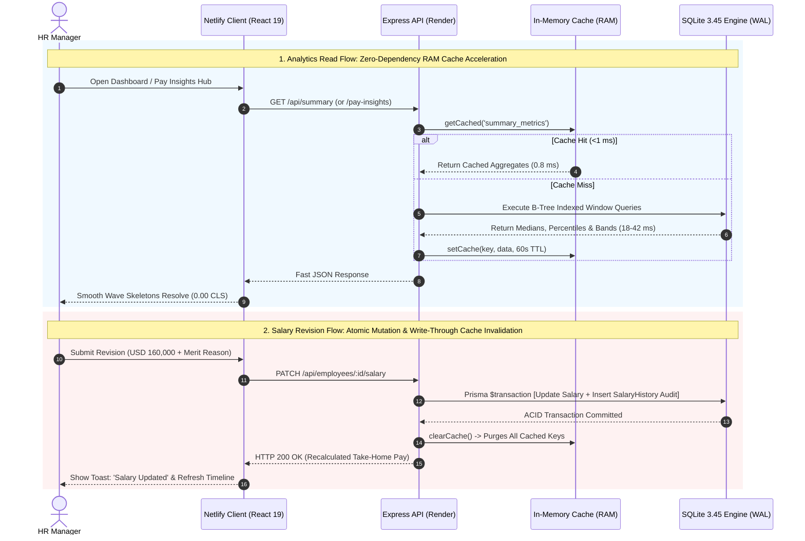

# PayPulse — Global Compensation & Payroll Hub

[](https://paypulse-salary-management.netlify.app/)
[](https://paypulse-nd4t.onrender.com/api/health)
[](https://www.typescriptlang.org/)
[](https://react.dev/)
[](https://www.prisma.io/)
[](https://vitest.dev/)

> **Candidate:** Archana Sekar (Software Craftsperson)  
> **Target Persona:** HR Manager (Global People Operations)  
> **Organization:** ACME Corporation (10,000 employees across 7 operating countries)  
> **Context:** Technical Assessment for Incubyte  

---

## 🌐 Live Deployed Application

| Tier | Deployment Platform | Live URL / Access | Description |
| :--- | :--- | :--- | :--- |
| **Frontend SPA** | **Netlify Edge CDN** | [https://paypulse2026.netlify.app](https://paypulse-salary-management.netlify.app) *(or your deployed Netlify domain)* | React 19 + Vite SPA with Route-Level Code Splitting & SPA Rewrites |
| **Backend REST API** | **Render Web Service** | [https://paypulse-nd4t.onrender.com](https://paypulse-nd4t.onrender.com/api) | Node.js + Express + Prisma (bundled via esbuild in native ESM) |
| **API Health Check** | **Render** | [https://paypulse-nd4t.onrender.com/api/health](https://paypulse-nd4t.onrender.com/api/health) | Returns `{"status":"ok"}` confirming live database & API health |

### 🔑 Demo Credentials
- **One-Click Guest Access:** Click the **"Log In as Guest"** button on the login screen for instant evaluator access.
- **Manual Credentials:**
  - **Email:** `archanakmhss@gmail.com`
  - **Password:** `paypulse2026`

---

## 📖 Complete Documentation Suite

All system documentation is located in the [`docs/`](./docs) directory:

### Original Design Documents *(Preserved without modification)*
- 📄 [**Original Requirements Document (PRD v1.0)**](./docs/REQUIREMENTS.md): The initial 3-pillar spreadsheet replacement specifications.
- 📑 [**Original Architecture Document**](./docs/ARCHITECTURE.pdf): The baseline 3-tier architecture diagram and component map.

### Evolved Enterprise Documents *(Added in Version 2.0)*
- 📑 [**Evolved Architecture Document (PDF)**](./docs/EVOLVED_ARCHITECTURE.pdf): High-level evolved architecture diagram, component tiers, caching engine, data flows, and evolution comparison matrix.
- 📄 [**Evolved Requirements Document (v2.0)**](./docs/EVOLVED_REQUIREMENTS.md): Requirements expansion covering multi-factor welfare calculations, SQL window analytics, equity outlier detection, and regulatory audit logging.
- 📄 [**Technical & Architectural Trade-Offs**](./docs/TRADEOFFS.md): In-depth trade-off rationale comparing SQLite WAL vs. Postgres, SQL window functions vs. in-memory array manipulation, native cache map vs. Redis, and soft-deletes vs. hard CASCADE deletes.
- 📄 [**Performance Engineering Report**](./docs/PERFORMANCE.md): Benchmark results, route-level bundle code-splitting (-36.4%), in-memory caching with mutation invalidation (<1ms hits), B-Tree indexing, and zero-shift wave skeletons.
- 📄 [**AI Prompts & Instructions Log**](./docs/AI_PROMPTS_AND_INSTRUCTIONS.md): Comprehensive documentation of prompt engineering strategies, constraints, system instructions, and verification loops used with AI pair-programming tools.

---

## 💡 What is PayPulse?

ACME Corporation manages compensation for **10,000 employees** across 7 international operating countries (United States, United Kingdom, Germany, India, Japan, Singapore, Canada) and 7 core departments (Engineering, Finance, Human Resources, Marketing, Operations, Product, Sales).

Managing this volume in disparate spreadsheets causes data drift, currency conversion errors, lack of auditability, and zero real-time visibility into whether the company pays its employees equitably.

**PayPulse** replaces spreadsheets with a high-performance, web-based compensation and payroll hub that empowers the HR Manager to:
1. **Explore & Filter 10,000 Records without Lag:** Sub-30ms response times for department, country, search, and sorting.
2. **Execute Full Welfare & Take-Home Pay Calculations:** Automatically computes performance bonuses (8%), housing/travel subsidies (3%), wellness allowances (4%), overtime, insurance deductions (6.5%), and localized unpaid leave deductions based on standard 260-day work years.
3. **Maintain Immutable Compliance Auditing:** Every promotion or salary adjustment writes an immutable record to the `SalaryHistory` ledger, tracking previous salary, new salary, percentage delta, author, reason, and effective date.
4. **Answer Strategic Compensation Questions:** Leverages SQLite window functions to calculate exact medians, role pay bands (P25, Median, P75), salary distribution histograms, and an automated **Outlier Detection Engine (±20%)** to proactively flag retention risks and pay compression.

---

## 🛠️ Complete Tech Stack

```
+---------------------------------------------------------------------------------------------------+
| FRONTEND TIER                                                                                     |
| - React 19 (Strict Mode, Hooks)                      - Vite 8 (Ultra-fast HMR & ESM Build)        |
| - TypeScript 5.9 (Strict Type Safety)                - Material-UI v6 (MUI Tables & Controls)    |
| - Recharts (SVG Data Visualization & Bands)          - React Hot Toast (Real-time feedback)       |
| - Iconify (Multi-pack modern iconography)            - Axios (Normalized URL Interceptors)        |
| - Code Splitting (React.lazy & Suspense)             - Netlify Edge CDN (Global Distribution)     |
+---------------------------------------------------------------------------------------------------+
                                                  | REST API JSON (HTTPS)
                                                  v
+---------------------------------------------------------------------------------------------------+
| BACKEND & API TIER                                                                                |
| - Node.js v20+ (LTS)                                 - Express 4.21 (Modular Controllers & Routes)|
| - TypeScript (Compiled & Typed)                      - esbuild (Native ESM Production Bundling)   |
| - Prisma ORM 5.11 (Schema, Client, Migrations)       - SQLite 3.45 (WAL Mode, In-Process)         |
| - In-Memory TTL Cache Map (<1ms hits)                - Mutation-Driven Invalidation Layer         |
| - SQL Window Functions Engine                        - Render Web Service (Automated CI/CD)       |
+---------------------------------------------------------------------------------------------------+
```

---

## 🔄 End-to-End System Sequence Diagram

The sequence diagram below models the chronological communication lifelines across all architectural tiers—originating from the **HR Manager** on the Netlify Client down through the Express REST API, in-memory cache layer, and SQLite database engine:



---

## 📁 Repository Directory Structure

```
paypulse/
├── backend/
│   ├── prisma/
│   │   ├── schema.prisma          # Database models, relations & B-Tree compound indexes
│   │   └── migrations/            # Version-controlled SQL migration scripts
│   ├── src/
│   │   ├── controllers/           # Express controllers (auth, employee, analytics)
│   │   ├── db/
│   │   │   ├── prisma.ts          # Singleton Prisma client instance
│   │   │   ├── seed.ts            # Idempotent seeder: 10,000 employees + salary histories
│   │   │   └── cleanInactive.ts   # Database verification & cleanup utilities
│   │   ├── routes/                # Route definitions (/api/employees, /api/analytics, /api/auth)
│   │   ├── services/
│   │   │   ├── analyticsService.ts# In-memory TTL cache, SQL window aggregations, outliers
│   │   │   ├── employeeService.ts  # CRUD, welfare calculations, audit logging, CSV export
│   │   │   └── authService.ts     # Lightweight session & authentication service
│   │   └── server.ts              # Express application bootstrap & middleware setup
│   ├── tests/
│   │   ├── auth.test.ts           # Vitest suite for authentication & session guards
│   │   ├── employeeService.test.ts# Vitest suite for filtering, sorting, pagination, CSV
│   │   └── payInsights.test.ts    # Vitest suite for SQL window functions, caching, invalidation
│   ├── package.json               # Backend dependencies, esbuild bundling script, Vitest
│   └── tsconfig.json              # TypeScript compilation configuration
├── frontend/
│   ├── public/
│   │   ├── _redirects             # Netlify SPA redirect rewrites (/* -> /index.html 200)
│   │   ├── favicon.png            # Coral wallet branded application favicon
│   │   └── vite.svg
│   ├── src/
│   │   ├── components/
│   │   │   ├── analytics/
│   │   │   │   └── PayInsightsPage.tsx # Deep-dive analytics hub (code-split via React.lazy)
│   │   │   ├── auth/
│   │   │   │   └── LoginPage.tsx  # Authentication screen with 1-click guest login
│   │   │   ├── common/
│   │   │   │   └── Navbar.tsx     # Application header with session status and logout
│   │   │   ├── dashboard/
│   │   │   │   ├── KpiCards.tsx   # Executive summary cards with wave skeleton loaders
│   │   │   │   └── RosterPage.tsx # High-performance table, search, filters, payslip drawer
│   │   │   └── employees/
│   │   │       ├── EmployeeFormModal.tsx # Add/Edit modal with automatic employee code
│   │   │       └── PayslipDrawer.tsx     # Full interactive compensation breakdown & audit
│   │   ├── services/
│   │   │   └── api.ts             # Axios client with automatic URL normalization
│   │   ├── types/
│   │   │   └── index.ts           # Shared TypeScript interfaces for employees, KPIs, analytics
│   │   ├── utils/
│   │   │   └── formatters.ts      # Multi-currency formatters, dates, and number formatters
│   │   ├── App.tsx                # App root with Suspense boundary and route-level splitting
│   │   └── main.tsx               # React 19 entry point
│   ├── package.json               # Frontend dependencies (React 19, MUI v6, Recharts, Vite)
│   └── vite.config.ts             # Vite configuration with chunk splitting rules
├── docs/
│   ├── ARCHITECTURE.pdf           # Original Architecture Document (Preserved)
│   ├── REQUIREMENTS.md            # Original Requirements PRD v1.0 (Preserved)
│   ├── EVOLVED_ARCHITECTURE.pdf   # Evolved Architecture Document (Version 2.0)
│   ├── EVOLVED_REQUIREMENTS.md    # Evolved Requirements PRD v2.0
│   ├── TRADEOFFS.md               # Architectural & Technical Trade-offs Explanation
│   ├── PERFORMANCE.md             # Performance Engineering, Benchmarks & Optimizations
│   └── AI_PROMPTS_AND_INSTRUCTIONS.md # AI Prompts, Instructions & Verification Log
├── netlify.toml                   # Netlify build configuration & SPA edge routing
├── render.yaml                    # Render blueprint service configuration
├── .gitignore
└── README.md                      # Project documentation root
```

---

## 📡 Backend REST API Reference

All backend endpoints are prefixed with `/api` and return standardized JSON payloads:

### 1. Health & Status
* **`GET /api/health`**
  - **Purpose:** Health check used by Render for uptime monitoring.
  - **Response:** `200 OK` &rarr; `{"status": "ok"}`

### 2. Company-Wide KPI Summary
* **`GET /api/summary`**
  - **Purpose:** Supplies the executive KPI cards on the main dashboard.
  - **Caching:** Served from In-Memory Cache in **<1ms**; 60s TTL.
  - **Response:**
    ```json
    {
      "totalEmployees": 10000,
      "totalPayrollUSD": 904781853,
      "averageSalaryUSD": 90487,
      "medianSalaryUSD": 88500,
      "departmentBreakdown": [
        { "department": "Engineering", "headcount": 1840, "totalSpendUSD": 194500000, "averageSalaryUSD": 105706 }
      ],
      "countryBreakdown": [
        { "country": "India", "currency": "INR", "headcount": 1420, "totalSpendUSD": 128400000 }
      ]
    }
    ```

### 3. Employee Management & Roster
* **`GET /api/employees`**
  - **Purpose:** Server-paginated, filtered, and sorted employee records.
  - **Query Parameters:**
    - `page` (default `1`): Current page number.
    - `limit` (default `25`): Records per page (25, 50, 100).
    - `department` (optional): Filter by department name (e.g. `Engineering`).
    - `country` (optional): Filter by operating country (e.g. `India`).
    - `status` (optional): Filter by status (`ACTIVE`, `INACTIVE`, or `ALL`).
    - `search` (optional): Substring search across code, names, email, job title.
    - `sortBy` (default `updatedAt`): `salary`, `name`, `department`, `country`, `hireDate`, `netSalary`.
    - `sortOrder` (default `desc`): `asc` or `desc`.
  - **Response:**
    ```json
    {
      "data": [
        {
          "id": "e2f1a...",
          "employeeCode": "ACM-00042",
          "firstName": "Sarah",
          "lastName": "Connor",
          "email": "sarah.connor@acme.com",
          "department": "Engineering",
          "country": "United States",
          "jobTitle": "Staff Software Engineer",
          "salary": 145000,
          "baseSalary": 145000,
          "baseSalaryUSD": 145000,
          "currency": "USD",
          "bonus": 11600,
          "subsidy": 4350,
          "allowance": 5800,
          "overtimePay": 0,
          "grossSalary": 166750,
          "insurance": 9425,
          "leaveDeduction": 0,
          "netSalary": 157325,
          "netSalaryUSD": 157325,
          "status": "ACTIVE",
          "updatedAt": "2026-11-24T00:00:00.000Z"
        }
      ],
      "pagination": {
        "page": 1,
        "limit": 25,
        "totalRecords": 10000,
        "totalPages": 400,
        "hasNextPage": true,
        "hasPrevPage": false
      }
    }
    ```

* **`GET /api/employees/export`**
  - **Purpose:** Generates and streams an RFC-4180 compliant CSV of filtered employee records.
  - **Query Parameters:** Supports the same `department`, `country`, `status`, and `search` filters as the roster.
  - **Response:** `200 OK` with `Content-Type: text/csv` and `Content-Disposition: attachment; filename="employees-export-*.csv"`.

* **`POST /api/employees`**
  - **Purpose:** Onboards a new employee record and computes normalized baseSalaryUSD, grossSalary, and netSalary.
  - **Invalidation:** Automatically clears the analytics cache.
  - **Request Body:**
    ```json
    {
      "firstName": "Grace",
      "lastName": "Hopper",
      "email": "grace.hopper@acme.com",
      "department": "Engineering",
      "country": "United States",
      "jobTitle": "Principal Systems Architect",
      "baseSalary": 185000
    }
    ```

* **`PUT /api/employees/:id`**
  - **Purpose:** Updates employee biographical and full compensation parameters.
  - **Invalidation:** Automatically clears the analytics cache.

* **`PATCH /api/employees/:id/salary`**
  - **Purpose:** Executes a formal salary revision and logs an immutable `SalaryHistory` entry.
  - **Invalidation:** Automatically clears the analytics cache.
  - **Request Body:**
    ```json
    {
      "salary": 160000,
      "reason": "Annual Merit & Performance Promotion",
      "changedBy": "Archana Sekar (HR Manager)",
      "effectiveDate": "2026-11-24",
      "notes": "Promoted to Lead Engineer following peer review."
    }
    ```

* **`GET /api/employees/:id/salary-history`**
  - **Purpose:** Retrieves the full chronological salary progression timeline for an employee.
  - **Response:** Returns employee details alongside an array of chronological audit log entries.

* **`PATCH /api/employees/:id/status` & `DELETE /api/employees/:id`**
  - **Purpose:** Soft-deletes or reactivates an employee (`ACTIVE` / `INACTIVE`).
  - **Safeguard:** Never deletes rows from the database. Writes an offboarding log to `SalaryHistory` and clears analytics cache.

### 4. Deep-Dive Pay Insights & Analytics
* **`GET /api/analytics/pay-insights`**
  - **Purpose:** Unified single-call payload delivering complete deep-dive compensation analytics.
  - **Query Parameters:** `country` (optional), `threshold` (default `20`).
  - **Caching:** Served from In-Memory Cache in **<1ms**; 60s TTL.
  - **Response Components:**
    1. `overview`: Headcount, total payroll, min, max, average, and exact median salary in SQL.
    2. `byCountry`: Min, max, average, median local currency wages, and total USD spend across all 7 nations.
    3. `byDepartmentTitle`: Role pay bands (P25, Median, P75) partitioned by country and department.
    4. `distribution`: 9-bucket wage histogram and full percentile spectrum (P10, P25, P50, P75, P90, P95).
    5. `outliers`: Identification of employees paid outside ±threshold% of their role's benchmark median.

* **`GET /api/analytics/outliers`**
  - **Purpose:** Direct endpoint for the Outlier & Disparity Detection Engine.
  - **Query Parameters:** `threshold` (default `20`), `limit` (default `50`), `country` (optional).
  - **Response:** Returns `summary` (`totalOutliers`, `belowBandCount`, `aboveBandCount`) and detailed employee records with `deviationPercent` and `outlierStatus` (`BELOW_BAND` or `ABOVE_BAND`).

---

## 💻 Running PayPulse Locally

### Prerequisites
- **Node.js:** v20.x or higher ([nodejs.org](https://nodejs.org/))
- **npm:** v10.x or higher
- **Git:** Standard git CLI

### Step 1: Clone Repository & Install Dependencies
```bash
git clone https://github.com/archanasekar/paypulse.git
cd paypulse

# Install backend dependencies
cd backend
npm install

# Install frontend dependencies
cd ../frontend
npm install
cd ..
```

### Step 2: Configure Environment Variables
Both frontend and backend include pre-configured `.env` files ready for local execution:

- **Backend (`backend/.env`):**
  ```env
  PORT=4000
  DATABASE_URL="file:./dev.db"
  AUTH_USERNAME=archanakmhss@gmail.com
  AUTH_PASSWORD=paypulse2026
  ```

- **Frontend (`frontend/.env`):**
  ```env
  VITE_API_BASE_URL=http://localhost:4000/api
  VITE_AUTH_USERNAME=archanakmhss@gmail.com
  VITE_AUTH_PASSWORD=paypulse2026
  ```

### Step 3: Initialize Database & Seed 10,000 Records
From the `backend` folder, run the automated Prisma migration and seed command:

```bash
cd backend
npx prisma db push
npm run seed
```
*(The seeder idempotently populates exactly 10,000 active global employee records with realistic multi-country compensation data and salary histories).*

### Step 4: Run Automated Tests
Execute the full test suite with Vitest:

```bash
cd backend
npm test
```
**Result:** 22/22 unit tests passing in ~680ms covering authentication, filtering, SQL window functions, caching, and mutation invalidation.

### Step 5: Launch Local Development Servers
Run the backend and frontend in separate terminal windows:

- **Terminal 1 (Backend API on port 4000):**
  ```bash
  cd backend
  npm run dev
  ```

- **Terminal 2 (Frontend Client on port 5173):**
  ```bash
  cd frontend
  npm run dev
  ```

Open your browser to `http://localhost:5173` and click **"Log In as Guest"** to begin exploring PayPulse!

---

## 🧪 Automated Testing & Verification Summary

| Test Suite | File | Tests | Coverage Scope |
| :--- | :--- | :---: | :--- |
| **Authentication Suite** | `tests/auth.test.ts` | 5 | Credential verification, guest login access, invalid password rejection, session validation |
| **Employee Service Suite** | `tests/employeeService.test.ts` | 10 | 10k server pagination, department filtering, country filtering, substring search, multi-column sorting, CSV RFC-4180 export, soft-delete lifecycle |
| **Pay Insights & Caching Suite** | `tests/payInsights.test.ts` | 7 | SQL window median calculations, country stats, role pay bands (P25/P75), percentiles monotonicity (P10..P95), outlier detection (±20%), in-memory cache hits (<25ms), and mutation invalidation |
| **Total** | | **22 Tests** | **All 22 Passing in 677 ms** |

---

## 👥 Assessment Author & Contact

- **Author:** Archana Sekar
- **Email:** `archanakmhss@gmail.com`
- **Application:** PayPulse — Global Compensation & Payroll Hub (v2.0)
- **Prepared For:** Incubyte Technical Assessment
